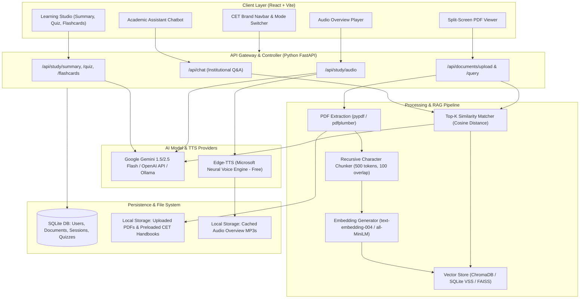
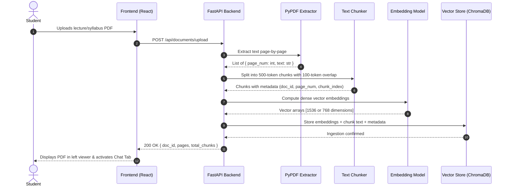

# ARCHITECTURE SPECIFICATION: CET AI
**IIT Patna — Centre for Educational Technology (CET)**  
*Technical Architecture, Data Flows, and System Design*

---

## 1. Architectural Philosophy: The "Companion Portal" Model

CET AI follows a **Decoupled Companion Architecture**. Rather than attempting to patch legacy Joomla PHP templates or connect directly to unauthorized institute internal databases, CET AI operates as an autonomous, high-speed modern service designed to sit seamlessly alongside the institutional website.

```
+-------------------------------------------------------------------------+
|                  Existing CET Website (cet.iitp.ac.in)                  |
|                [ Joomla CMS | Apache / PHP | MySQL DB ]                 |
+-------------------------------------------------------------------------+
                                     |
               Public Data Mirror / Document Scraping (One-time)
                                     v
+-------------------------------------------------------------------------+
|                  CET AI Companion Application (Capstone)               |
|  +------------------------------+     +-------------------------------+ |
|  |     Frontend Web Client      | <-> |       FastAPI Backend         | |
|  |   React (Vite) + Vanilla CSS |     |    Python 3.11+ / SQLite      | |
|  +------------------------------+     +-------------------------------+ |
|                                                       |                 |
|            +------------------------------------------+                 |
|            v                                          v                 |
|  +--------------------+                     +--------------------+      |
|  |   RAG Engine       |                     | Audio Synthesis    |      |
|  | ChromaDB / Embeddings                    | Edge-TTS / MP3     |      |
|  +--------------------+                     +--------------------+      |
+-------------------------------------------------------------------------+
```

### Why This Architecture Fits a Student Team:
1. **Clear Separation of Concerns:** Frontend and backend can be developed and tested completely independently using REST APIs and Swagger documentation (`/docs`).
2. **Zero Deployment Risk to Institute:** No risk of downtime, security breach, or administrative disruption to IIT Patna's production servers.
3. **Reproducibility:** A new team member can clone the repository, install Python and Node dependencies, and run the entire system locally on Windows, macOS, or Linux in under 5 minutes without configuring Docker or enterprise databases.

---

## 2. End-to-End System Architecture



---

## 3. Component Deep Dive

### 3.1 Client Layer (Frontend)
- **Framework:** React 18 with Vite for ultra-fast Hot Module Replacement (HMR).
- **Styling Strategy:** Vanilla CSS / CSS Modules with strict CSS custom properties (`--color-iitp-navy: #002147`, `--color-iitp-gold: #d4af37`, `--color-bg: #f8fafc`).
- **Core Views:**
  1. **CET Portal & General Assistant:** Instant institutional query bar with recommended topic chips (e.g., *"BS AICS Eligibility"*, *"Evaluation Scheme"*, *"Holiday List 2025"*).
  2. **Interactive Study Workspace:** Split-view layout:
     - Left Panel: Native PDF canvas viewer (`pdfjs-dist` or `react-pdf`) with search and text highlight capability.
     - Right Panel: Multi-tab workspace featuring:
       - Tab A: Grounded Contextual Chat with citation tags.
       - Tab B: Document Executive Summary & Key Terms.
       - Tab C: Diagnostic Quiz with interactive score calculation.
       - Tab D: Revision Flashcards with 3D flip card dynamics.
       - Tab E: Audio Overview Player with play, pause, and speed toggle.

### 3.2 Service Layer (Python FastAPI)
FastAPI was selected over Django or Flask because:
- **Asynchronous Performance:** Native `asyncio` for non-blocking LLM streaming and file handling.
- **Interactive Documentation:** Automatic OpenAPI generation at `http://localhost:8000/docs`, allowing any student team member to test endpoints in a visual web UI without writing Postman scripts.
- **Type Safety:** Pydantic models enforce strict data validation on incoming requests and outgoing responses.

#### Key API Endpoint Specification:
| Method | Endpoint | Description | Request Payload | Response |
| :--- | :--- | :--- | :--- | :--- |
| `GET` | `/api/health` | Healthcheck & system status | None | Status message & active LLM engine |
| `POST`| `/api/chat` | Institutional assistant query | `{ "query": str, "session_id": str }` | `{ "response": str, "sources": list }` |
| `POST`| `/api/documents/upload` | Upload PDF for RAG ingestion | Multipart Form (`file: UploadFile`) | `{ "doc_id": str, "title": str, "pages": int }` |
| `POST`| `/api/documents/{id}/query`| Grounded query against document | `{ "query": str }` | `{ "response": str, "citations": list }` |
| `POST`| `/api/study/summary` | Generate study guide | `{ "doc_id": str }` | `{ "summary": str, "key_concepts": list }` |
| `POST`| `/api/study/quiz` | Generate MCQs from document | `{ "doc_id": str, "count": int }` | `{ "questions": [ { "id", "question", "options", "answer", "explanation" } ] }` |
| `POST`| `/api/study/flashcards` | Generate revision cards | `{ "doc_id": str, "count": int }` | `{ "cards": [ { "front", "back", "category" } ] }` |
| `POST`| `/api/study/audio` | Synthesize audio overview | `{ "doc_id": str }` | `{ "audio_url": str, "script": str }` |

### 3.3 Document Ingestion & RAG Pipeline



### 3.4 Grounding & Citation Mechanism
To prevent LLM hallucination and ensure academic integrity:
1. **Metadata Tagging:** During chunking, every text fragment retains:
   - `document_name`: e.g., `AICS_Curriculum_2024.pdf`
   - `page_number`: e.g., `Page 7`
   - `section_header`: e.g., `Semester III Course Structure`
2. **Context Window Injection:** The Top-K most similar chunks are structured in the prompt:
   ```text
   [SOURCE 1] (File: AICS.pdf, Page 7)
   "CS201: Data Structures and Algorithms requires 4 lecture hours per week..."

   [SOURCE 2] (File: Evaluation_Scheme.pdf, Page 2)
   "Continuous assessment carries 40% weightage, and End-Semester carries 60%..."
   ```
3. **Structured System Directive:**
   > *"You are CET AI, an academic assistant for IIT Patna CET. Answer the student's question using ONLY the provided sources above. If the information is not in the text, clearly state that you do not have enough information. Always cite your sources in the text using format [DocName, Page X]."*
4. **Citation Extraction:** The backend parses brackets or returns structured citation objects alongside the markdown response so the frontend renders clickable citation badges.

### 3.5 Audio Learning (AI Spoken Audio Overview)
- **Script Generation:** The LLM receives the document summary and generates a lively 2-minute dialogue or spoken monologue summarizing core concepts in conversational language.
- **Speech Synthesis:** Uses `edge-tts` (Microsoft Neural Voice Engine) via Python.
  - **Zero Cost:** Free and requires no external credit card or paid cloud subscription.
  - **High Naturalness:** Sounds fluid, expressive, and human-like (`en-IN-NeerjaNeural` or `en-US-ChristopherNeural`).
  - **Offline Caching:** Audio files are saved as `.mp3` in the backend static cache, served via `/static/audio/{hash}.mp3`.

---

## 4. Database Schema (SQLite)

The system uses an embedded SQLite database (`cet_ai.db`). It requires zero installation and can be inspected visually using standard VS Code extensions or DB Browser for SQLite.

```sql
-- Track uploaded and preloaded documents
CREATE TABLE documents (
    id TEXT PRIMARY KEY,
    title TEXT NOT NULL,
    filename TEXT NOT NULL,
    file_path TEXT NOT NULL,
    page_count INTEGER NOT NULL,
    is_institutional BOOLEAN DEFAULT 0,
    created_at TIMESTAMP DEFAULT CURRENT_TIMESTAMP
);

-- Store conversational history
CREATE TABLE chat_sessions (
    id TEXT PRIMARY KEY,
    document_id TEXT NULL,
    created_at TIMESTAMP DEFAULT CURRENT_TIMESTAMP,
    FOREIGN KEY (document_id) REFERENCES documents(id)
);

CREATE TABLE chat_messages (
    id TEXT PRIMARY KEY,
    session_id TEXT NOT NULL,
    sender TEXT NOT NULL, -- 'user' or 'assistant'
    content TEXT NOT NULL,
    citations_json TEXT NULL,
    created_at TIMESTAMP DEFAULT CURRENT_TIMESTAMP,
    FOREIGN KEY (session_id) REFERENCES chat_sessions(id)
);

-- Store generated study artifacts
CREATE TABLE study_artifacts (
    id TEXT PRIMARY KEY,
    document_id TEXT NOT NULL,
    artifact_type TEXT NOT NULL, -- 'summary', 'quiz', 'flashcard', 'audio'
    content_json TEXT NOT NULL,
    created_at TIMESTAMP DEFAULT CURRENT_TIMESTAMP,
    FOREIGN KEY (document_id) REFERENCES documents(id)
);
```

---

## 5. Security, Privacy, and Cost Optimization

### 5.1 Security Controls
- **File Upload Guardrails:**
  - Allowed file types strictly restricted to `.pdf` (validated via magic bytes and MIME type).
  - Maximum upload size capped at 15MB to prevent memory exhaustion.
  - Filenames sanitized using UUIDs to prevent directory traversal attacks (`../../etc/passwd`).
- **No Inbound Webhooks / Open Ports:** Runs locally on `localhost:8000` (backend) and `localhost:5173` (frontend).

### 5.2 Privacy & Data Hygiene
- All uploaded student documents remain on the local host machine.
- No personal student identification numbers, phone numbers, or passwords are required to use the system.

### 5.3 API Cost & Rate Limit Management
- **Free Tier Utilization:** Uses **Google Gemini 1.5/2.5 Flash**, which offers a generous free rate limit (up to 15 RPM and 1 million tokens/minute on Google AI Studio), costing zero dollars for capstone development and live jury demonstrations.
- **Embedding Efficiency:** Chunks are embedded once upon upload and saved to disk in ChromaDB. Recurring queries against the same document reuse the existing vector index without re-embedding.
- **Local Fallback Option:** Compatible with **Ollama** (`llama3.2` or `mistral`) so the entire project can run 100% offline in case Internet connectivity fails during the final capstone presentation.
